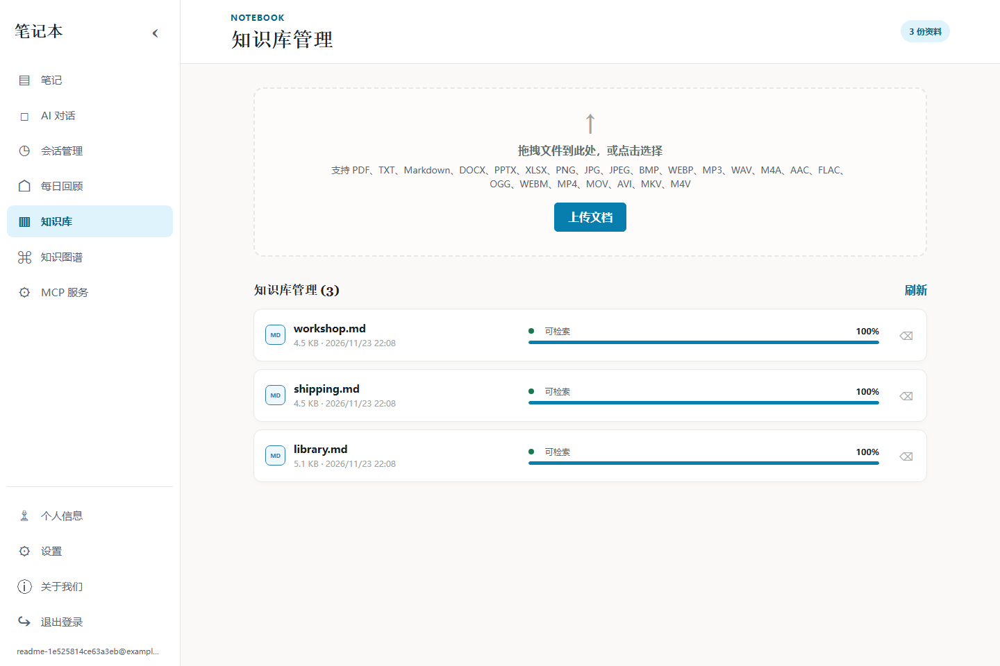
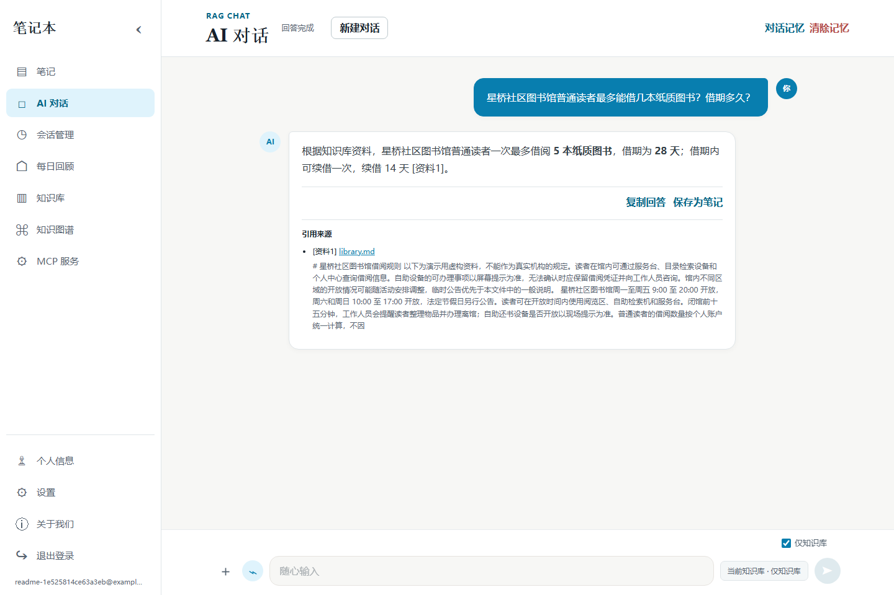
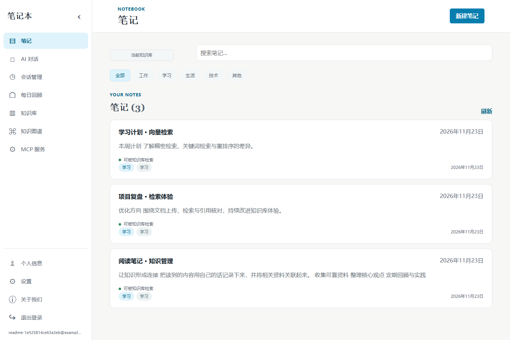
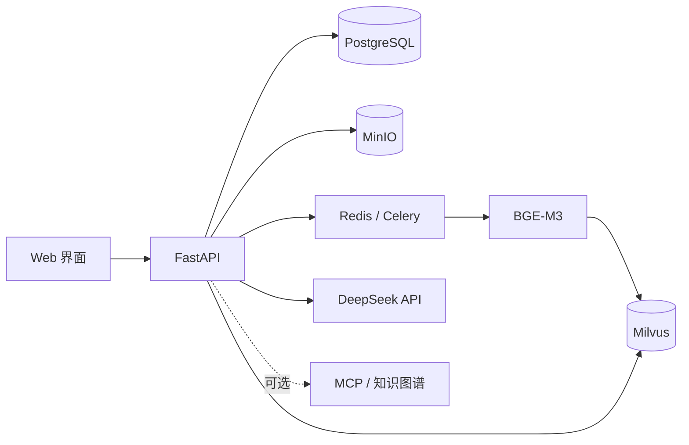

# MCP-RAG-Notebook

个人知识管理与知识库问答项目。文档上传后由 Celery 异步解析和建立向量索引；检索使用 BGE-M3、Milvus 稠密/稀疏召回和 RRF 融合，可选 BGE Reranker。系统还包含笔记、知识图谱、MCP 工具和 AI 写作功能。

## 核心功能

- **知识库问答**：上传文档后异步解析和索引，通过混合检索获取相关片段，回答附带来源供核对。
- **笔记与写作**：管理 Markdown 笔记，使用 AI 辅助续写、扩写和摘要。
- **知识连接**：通过知识图谱和相关内容推荐探索资料之间的联系。
- **对话与工具**：保存会话历史，并提供可配置的 MCP 工具扩展。

## 项目演示

以下截图来自当前项目，内容为虚构的演示资料。

**知识库管理**：查看上传文档及处理状态。

**知识库问答**：根据检索到的资料回答，并展示引用来源。

**笔记管理**：浏览、筛选和管理笔记。

## 系统架构

