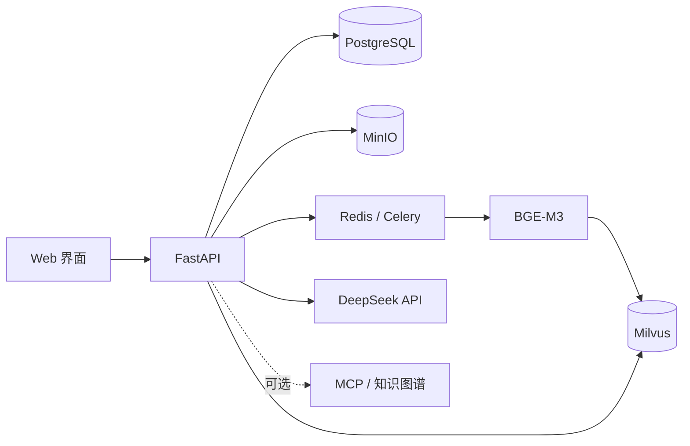

# MCP-RAG-Notebook

个人知识管理与知识库问答项目。文档上传后由 Celery 异步解析和建立向量索引；检索使用 BGE-M3、Milvus 稠密/稀疏召回和 RRF 融合，可选 BGE Reranker。系统还包含笔记、知识图谱、MCP 工具和 AI 写作功能。

本项目参考 [RMA-MUN/RAGNotebook](https://github.com/RMA-MUN/RAGNotebook)，保留其 MIT 许可证及版权声明，具体实现和技术选型有所调整。



> 当前项目仍在进行可复现部署和端到端验收。以下为本地开发配置，不代表生产环境已经完成安全加固。不要将数据库、对象存储或 MCP 服务直接暴露到公网。

## 环境要求

- Docker Desktop 或 Docker Engine + Compose；首次构建需要访问 Docker 镜像仓库、Python 和 npm 包仓库。
- Compose 构建使用 Python 3.11 和 Node.js 24；演示脚本只依赖宿主机 Python 3.11+ 标准库。手动开发时前端运行 `cd frontend && npm ci`，后端在 Python 3.11 虚拟环境中先运行 `python -m pip install --index-url https://download.pytorch.org/whl/cpu torch==2.13.0+cpu`，再运行 `python -m pip install -r backend/requirements.txt`。
- BGE-M3 在本地运行，需要预留数 GB 磁盘和足够内存。首次加载和 CPU 推理可能较慢；后端与 worker 都会加载模型，内存占用会叠加。
- 文档问答、AI 写作和实体抽取需要有效的 DeepSeek API 凭据和网络连接。多模态、部分 MCP 工具另有各自依赖或凭据。
- 首次模型下载需要从 Hugging Face 及其权重分发域名下载数据；无法连接时应先准备模型文件或配置可用网络。仅能访问 Hugging Face 首页并不代表权重下载可用。

## 本地启动

1. 将 `.env.example` 复制为 `.env`，设置 `POSTGRES_PASSWORD`、`MINIO_ROOT_PASSWORD`、`JWT_SECRET_KEY` 和 `DEEPSEEK_API_KEY`。不要提交 `.env` 或公开密钥。
2. 默认 `HF_CACHE_DIR=hf_cache` 使用 Docker 管理的共享模型缓存卷；`EMBEDDING_OFFLINE=false` 允许首次下载。网络受限时，可提前准备完整模型并在容器中配置本地模型路径；确认模型可加载后再设置 `EMBEDDING_OFFLINE=true`。
3. 在项目目录执行 `docker compose up -d --build`，再用 `docker compose ps` 和 `docker compose logs --tail=100 backend celery-worker` 查看状态。后端启动时执行数据库迁移和 Milvus collection 初始化。
4. 访问 `http://127.0.0.1:3000` 注册并登录。API 地址为 `http://127.0.0.1:18765`。`/health` 仅表示 API 进程可响应，不代表模型、索引或外部 LLM 已可用；以实际上传和检索验证为准。

Compose 使用具名卷保存数据库、对象存储、向量索引和模型缓存。不要使用 `docker compose down -v`，除非明确要删除这些卷中的数据。修改 `.env` 后需重新创建受影响的容器。

在 Linux/macOS 或支持 Docker 的 Bash 中，首次设置 DeepSeek 密钥后也可执行一键构建、启动、导入并问答：

```bash
export DEEPSEEK_API_KEY='你的密钥'
bash scripts/setup.sh
```

脚本只在 `.env` 不存在时生成本地配置；已有 `.env` 时沿用其中的设置。脚本会先下载并执行一次 Embedding 模型，再启动服务，避免模型不可用时误以为系统已经准备好。它会创建一个随机演示账号，及其知识库和文档保留在本地数据库中。首次拉取镜像、下载模型并索引可能需要数分钟或更久，取决于网络和 CPU。

如果容器需要代理访问 Hugging Face，执行脚本前可设置 `CONTAINER_HTTP_PROXY` 和 `CONTAINER_HTTPS_PROXY`（例如 Docker Desktop 中可达的 `http://host.docker.internal:7897`）。脚本会将其传给构建步骤，并在首次生成 `.env` 时写入运行时配置；已有 `.env` 时需自行检查运行时代理。构建中需要直连的域名可通过 `CONTAINER_NO_PROXY` 指定，例如 `deb.debian.org`。镜像仓库访问还需要 Docker 守护进程能联网。DeepSeek 默认直连；如果 DeepSeek 也必须使用代理，可在 `.env` 中设置 `DEEPSEEK_TRUST_ENV=true` 后重新创建服务。

## 30 秒演示入口

服务已运行时，在项目根目录执行：

```bash
python3 demo/run_demo.py
```

脚本自动上传 `demo/data/` 的三份虚构资料，等待索引，再打印三个问题、来源、真实模型回答和耗时。名称表示快速体验入口，并非 30 秒性能保证：首次索引和模型冷启动通常会超过 30 秒。每次运行创建新的演示账号，不覆盖现有文档；运行需要 Docker 服务正常、DeepSeek 凭据及网络。Windows 可使用 `python demo/run_demo.py`。

运行四条真实模型问答（含无依据问题）并生成 `eval/report.md`：

```bash
python3 eval/run_e2e.py
```

每次均会产生新的演示账号和模型调用费用；评测检查预期来源和答案关键词，不能替代人工语义审查。

一次实际运行的输入、来源、模型输出和耗时见 [真实问答评测报告](eval/report.md)。

### 提前准备模型

构建后端镜像后，可在启动完整服务前运行以下命令，下载配置的 Embedding 模型并执行一次真实向量化。默认缓存卷由后端和 worker 共用，首次下载需要时间及稳定的网络。

```bash
docker compose build backend
docker compose run --rm --no-deps backend python -m app.scripts.prepare_models
```

检索对照评测还需要可选的 Reranker；运行下列命令会准备并实际执行两个模型。该模型体积和 CPU 推理开销较大，普通问答默认不启用它。

```bash
docker compose run --rm --no-deps backend python -m app.scripts.prepare_models --reranker
```

可用 `--offline` 检查缓存是否足以实际加载和推理，例如：

```bash
docker compose run --rm --no-deps backend python -m app.scripts.prepare_models --offline --reranker
```

只验证 Embedding 时省略 `--reranker`。离线选项禁用 Hugging Face 联网加载，但不会切断容器网络。使用在线下载命令时请确认 `EMBEDDING_OFFLINE=false`；访问 Hugging Face 受限时，需为容器配置可访问的 HTTP/HTTPS 代理（容器内 `127.0.0.1` 并非宿主机）。离线验证通过后，如需服务始终离线运行，可在 `.env` 中设置 `EMBEDDING_OFFLINE=true` 并重新创建服务。模型缓存独立于数据库和上传文档，请妥善保留。

也可以事先取得完整的 `BAAI/bge-m3` 模型目录，放到项目的 `huggingface/prepared/bge-m3/`（目录中应直接包含 `config.json`、`pytorch_model.bin`、分词器和稀疏投影权重）。在 `.env` 中设置 `HF_CACHE_DIR=./huggingface`、`EMBEDDING_MODEL=/root/.cache/huggingface/prepared/bge-m3`、`EMBEDDING_OFFLINE=true`，再运行上面的 `prepare_models --offline` 检查。此方法需要明确准备模型文件，并不从仓库附带权重；模型文件不应提交到 Git。

固定版本的 MinIO 镜像若无法从镜像仓库拉取，一键脚本会尝试从固定提交的 MinIO 源码构建后备镜像，并将镜像名写入 `.env`；这还需要访问 GitHub、Go 下载与模块仓库和 Debian 软件源。后备镜像包含 Compose 健康检查需要的 `curl`。MinIO 本身采用 AGPL-3.0，源码构建的完整来源见 [MinIO 仓库](https://github.com/minio/minio)。已有本地镜像缓存不等同于验证了新机器的镜像获取。

Go 默认模块仓库访问缓慢时，可在执行脚本前设置 `GO_MODULE_PROXY`（例如 `https://goproxy.cn,direct`）；Go 仍会按项目的校验和验证模块。代理可用性和网络条件会影响构建时间。

## 演示数据与检索评测

项目附带三篇**虚构**资料和 30 条切片级相关性标注，用于检查评测流程；它们不是现实场景测评集，也不足以证明检索质量优于其他方案。请在独立的测试账号、空知识库中使用，不要将私有文件当作公开演示数据。

先在网页注册测试账号，然后在容器里执行（导入器要求该账号的知识库没有文档）：

```bash
docker compose exec -it backend python -m app.scripts.import_demo --email YOUR_TEST_EMAIL
```

输入密码后，脚本上传三份资料，等待索引并显示用户和知识库 ID。文件处理失败或超时会停止；已有文档不会被删除。如果导入中断，先在页面检查状态并按需重试，不要重复导入到含文档的知识库。

按上文准备 `BAAI/bge-reranker-v2-m3` 后，可在后端容器中以显示的 ID 运行：

```bash
docker compose exec -T backend python -m app.scripts.evaluate_retrieval \
  --user-id USER_UUID --knowledge-base-id KNOWLEDGE_BASE_UUID \
  --labels app/scripts/demo_data/retrieval_labels.json --k 1 > retrieval-report.json
```

程序比较 Dense、Hybrid 和 Hybrid + Reranker，输出切片级 Recall@K、MRR@K、每题标注目标、实际排序结果、用时及延迟中位数；模型预热不计入查询时间。它对每个问题计算一次向量，并将相同向量的耗时计入三个方案。Hybrid 和重排使用相同候选；重排加载或执行失败时直接报错，不生成伪造的对照结果。评测前会对标注目标切片的 SHA-256、Milvus 中的内容和所属用户/知识库做一致性检查，不一致即停止；检查不验证向量数值本身是否由当前模型生成。更换文档或切分方式后，应人工重新核对标签再更新指纹，不能仅为消除错误而更新。评测输出包含标注文件哈希和模型配置，但模型别名尚未固定到权重版本；要做严谨对照，应记录模型权重版本、运行环境和多轮测量结果。该流程不评估回答是否有依据、引用是否正确或无依据时是否拒答。

一次示例运行结果及其限制见 [检索对照冒烟记录](docs/retrieval-smoke-report.md)。

## 目前的边界

- 前端默认使用 Agent 自动路由；选择“仅知识库”后使用知识库问答接口，无检索结果时返回资料不足。检索命中并不保证内容足以回答，仍需通过引用和拒答评测验证模型表现。
- 示例配置关闭自动图谱抽取，以免外部模型调用阻塞单 worker 的文档索引；仍可在图谱页面手动构建，或设置 `GRAPH_AUTO_EXTRACT_ENABLED=true` 恢复自动抽取。
- 默认关闭 `fetch` 和 `filesystem` MCP 服务，且二者均不在默认 Agent/客户端工具白名单中。Fetch 目前仍不能完整防范 DNS 重绑定；filesystem 工作目录由服务进程共享、不提供按用户隔离。不要在多用户环境中启用它们访问不可信 URL 或私有文件。
- 默认 `MCP_DYNAMIC_REGISTRY_ENABLED=false`：运行时只采用受信任的 `mcp_servers/servers.json`，忽略数据库中的动态定义，并拒绝通过 API 增删改全局服务。动态配置能启动任意本地命令，启用它会允许任何已登录用户修改全局配置；仅供完全可信的单用户本地环境使用，并非管理员权限系统。
- 默认 Compose 的数据服务端口仅绑定到宿主机回环地址；前端和 API 仍监听宿主机网络，公网部署需要另行配置网络隔离、TLS、访问控制、备份与密钥管理。
- 此仓库尚未提供经人工独立复核的真实任务评测集、完整的引用/拒答评测报告或并发压测结果。
